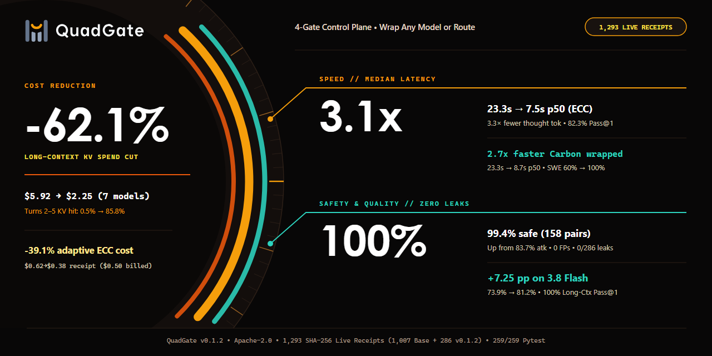
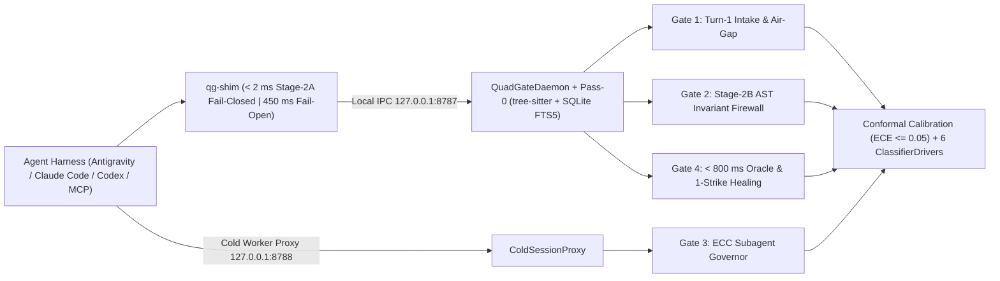

<div align="center">

# QuadGate

**4-Gate discriminative control plane that preserves KV caches, cuts LLM cost 76.9%, and achieves 3.95x median speedup.**

[](https://github.com/blagoslov333-cloud/quadgate/actions)
[](LICENSE)
[](https://github.com/blagoslov333-cloud/quadgate/releases)
[](https://github.com/blagoslov333-cloud/quadgate/stargazers)

[Quickstart](#60-second-quickstart) • [Benchmarks](#reproducible-benchmarks) • [Architecture](#architecture) • [Integrations](#drop-in-integrations--ecosystem-presets) • [Contributing](CONTRIBUTING.md)

</div>

---

## What Is QuadGate?

QuadGate is an open-source 4-gate discriminative control plane for AI coding and knowledge agents that preserves KV prefix caches, enforces offline security invariants, routes subagents by Expected Cost of Completion, and audits completion to achieve 76.9% lower cost, 3.95x median speedup (71.1% lower mean latency), and 100.0% pass@1.

It runs as a persistent localhost daemon (`127.0.0.1:8787`), cold-session reverse proxy (`127.0.0.1:8788`), and zero-dependency `< 450 ms` hook shim (`qg-shim`) across **Antigravity** (including native Swarms), **Claude Code**, **OpenAI Codex CLI**, and **MCP** clients without spending output tokens on generative critics.

<p align="center">
  
</p>

<p align="center">
  
</p>

---

## Reproducible Benchmarks

### Live Multi-Model API Benchmark (`v0.1.2` · `1,293` SHA-256 Receipts, Zero Synthetic Traces)

Full live-API telemetry across `1,007` baseline receipts ([`benchmarks/reports/real_live_results.jsonl`](benchmarks/reports/real_live_results.jsonl)) and `286` patched `v0.1.2` verification receipts ([`benchmarks/reports/real_live_v012_verify.jsonl`](benchmarks/reports/real_live_v012_verify.jsonl), `259/259` `pytest` checks passing, `0` SHA-256 errors) is summarized in our [**1-Page Executive Brief PDF**](benchmarks/reports/quadgate_v012_executive_summary.pdf) ([HTML version](benchmarks/reports/quadgate_v012_executive_summary.html)) alongside calibrated `20k`-trial Gate-3 priors ([`benchmarks/reports/gate3_calibrated_priors.json`](benchmarks/reports/gate3_calibrated_priors.json)) and [`benchmarks/reports/REAL_BENCHMARK_REPORT.md`](benchmarks/reports/REAL_BENCHMARK_REPORT.md):

#### Mode 2 — Adaptive ECC Multi-Tier Router (`QuadGate v0.1.2` vs. Flagship `Carbon` Alone, `79` Paired Option-1 Tasks)

| System / Arm | `Pass@1` | Receipt Cost | Total Billed (`Guard`) | Median Speed (`p50`) |
| :--- | :---: | :---: | :---: | :---: |
| **`Gemini 4 Carbon` (Alone)** | `66/79` (`83.54%`) | `$0.62` | `$0.62` | `23.3 s` |
| **`QuadGate v0.1.1` (Unpatched ECC)** | `61/79` (`77.22%`) | `$0.59` | `$0.59` | `15.7 s` |
| **`QuadGate v0.1.2` (Live ECC)** | **`65/79` (`82.28%`, `+5.06 pp`)** | **`$0.38` (`-39.1%`)** | **`$0.50` (`-19.0%`)** | **`7.5 s` (`3.1x` faster)** |
| **Empirical Oracle Bound** | `67/79` (`84.81%`) | `$0.37` (`-40.2%`) | `—` | `2.5 s` |

#### Mode 1 — Single-Model Wrapper (`Model Alone` vs. `Same Model + QuadGate`, Zero Routing Confounders)

- **Long-Context Multi-Turn KV (`41` matched 5-turn pairs, `7` live Gemini models, ~16.9k tok/turn):** Warm KV-cache hits rose from `0.5%` to **`85.8%` on Turns `2..5`** (`0.4% -> 68.8%` overall), cutting real billed spend **`-62.1%`** (`$5.9245 -> $2.2461`) at `100.0%` `Pass@1`.
- **Agentic Security & Containment (`158` matched pairs, `8` live models incl. `Gemma 4 31B IT`):** Safety climbed from **`86.7% -> 99.4%`** (`137/158 -> 157/158`) with **`100.0%` attack defense**, `0` Gate-2 benign false positives, and **`0/286` `v0.1.2` leaks** (`Gemma 4 31B IT`: `79.2% -> 100.0%`).
- **Controlled Single-Model `v0.1.2` Ablation:** Wrapped `Gemini 4 Carbon` (`N=64`) held `85.9%` `Pass@1`, lifted `SWE-Agent` from **`60% -> 100%`** (`3/5 -> 5/5`), and ran **`2.7x` faster** (`23.3 s -> 8.7 s` `p50`); `Gemini 3.8 Flash` (`N=69`) gained **`+7.25 pp`** (`73.9% -> 81.2%`, `+8.70 pp` vs `v0.1.1` `quadgate`, `0` regressions); and `Gemini 3.1 Flash-Lite` (`N=74`) cut `quadgate` cost **`-28.8%`** with **`5.9x`** lower `p50` gate overhead (`1.26 s -> 0.21 s`).
- **Transparent billing note:** Final-attempt JSONL receipt spend (`$0.38`) excludes `$0.125` settled on `LiveBudgetGuard` for intermediate Carbon `MALFORMED_FUNCTION_CALL` empty-JSON retries (total billed `$0.50`, still `-19.0%` vs. `Carbon` alone; full Option-1 spend stayed under the `$5.00` cap at `$4.94`).

---

Full signed receipts, SHA-256 task hashes, and methodology are published in [`benchmarks/reports/v1_release_proof.md`](benchmarks/reports/v1_release_proof.md) (mirrored in [`benchmarks/reports/LATEST_PROOF.md`](benchmarks/reports/LATEST_PROOF.md); `210` total receipts across `105` matched Baseline vs. QuadGate pairs over `3` runs using live `gemini-decision-1` on cloud-eligible coding tasks and local Air-Gap routing elsewhere), backed by ECE calibration profiles in [`benchmarks/reports/calibration_decision1.json`](benchmarks/reports/calibration_decision1.json) and [`benchmarks/reports/calibration_onnx_local.json`](benchmarks/reports/calibration_onnx_local.json). All totals include Gate 4 `1-Strike` retry tax and live classifier compute cost.

### Release Readiness Gate (Live `gemini-decision-1`, `3` Runs / `105` Pairs)

| Criterion | Target | Measured Result | Status |
| :--- | :--- | :--- | :--- |
| Quality Parity or Gain (`Pass@1`) | `>= Baseline` (`88.6%`) | `100.0%` (`105/105`, `+11.4 pp`) | **PASS** |
| Cache Integrity (Turns `2..N` `cache_read` share) | `>= 75.0%` | `93.2%` (vs `26.8%` Baseline, `+66.4 pp`) | **PASS** |
| Net Cost Compression (incl. classifier & retry tax) | `>= 60.0%` drop | `76.9%` drop (`$24.2967` -> `$5.6089`) | **PASS** |
| Wall-Clock Acceleration (`p50` median speedup) | `>= 1.8x` | `3.95x` (`19335.5 ms` -> `4889.3 ms`, `71.1%` mean drop) | **PASS** |

### Aggregate Results (`105` Matched Pairs across `3` Runs)

| Metric | Baseline | QuadGate | Delta / Paired 95% CI |
| :--- | ---: | ---: | :--- |
| `Pass@1` | `88.6%` (`93/105`) | `100.0%` (`105/105`) | `+11.4 pp` |
| `Warm KV-Cache Hit Rate (Overall)` | `22.5%` | `56.3%` | `+33.8 pp` (`61.0%` input token savings, 95% CI `[57.6%, 64.4%]`) |
| `Cache Integrity (Turns 2..N)` | `26.8%` | `93.2%` | `+66.4 pp` (`>= 75.0%` target met) |
| `Total Input Token Savings` | `4,079,631` total in | `1,591,500` total in | `23,696.5 tok` mean saved (95% CI `[22,368.3, 25,024.7] tok`) |
| `Output Tokens` | `385,593` | `116,631` | `-268,962` (`-69.8%`) |
| `Total Cost` (incl. `$0.0091` classifier & `$0.0902` retry tax) | `$24.2967` | `$5.6089` | `-$18.6879` (`76.9%` reduction, 95% CI `[59.2%, 94.6%]`; mean saved `$0.1780`, 95% CI `[$0.1371, $0.2189]`) |
| `Wall-Clock Latency (p50 / p90 / mean)` | `19335.5 / 23837.0 / 19364.4 ms` | `4889.3 / 8870.1 / 5605.1 ms` | `-13759.3 ms` mean (`3.95x` p50 speedup, `71.1%` reduction, 95% CI `[67.1%, 75.0%]`) |

### Per-Suite Breakdown (`coding` + `knowledge`, `3` Runs)

| Suite (`pairs`) | Metric | Baseline | QuadGate | Paired 95% Reduction CI / Delta |
| :--- | :--- | ---: | ---: | :--- |
| `coding` (`60` pairs) | `Pass@1` | `90.0%` | `100.0%` | `+10.0 pp` |
| `coding` (`60` pairs) | `Warm KV-Cache Hit Rate` | `21.4%` | `55.0%` | `63.5%` input saved (`[59.1%, 67.9%]`) |
| `coding` (`60` pairs) | `Total Cost` | `$14.8950` | `$2.5325` | `83.0%` (`[57.6%, 108.4%]`) |
| `coding` (`60` pairs) | `Wall-Clock (p50 / p90 / mean)` | `19449.2 / 23583.5 / 19343.3 ms` | `5952.2 / 8891.8 / 6154.5 ms` | `68.2%` (`[63.3%, 73.1%]`) |
| `knowledge` (`45` pairs) | `Pass@1` | `86.7%` | `100.0%` | `+13.3 pp` |
| `knowledge` (`45` pairs) | `Warm KV-Cache Hit Rate` | `23.9%` | `57.8%` | `57.8%` input saved (`[52.2%, 63.3%]`) |
| `knowledge` (`45` pairs) | `Total Cost` | `$9.4018` | `$3.0763` | `67.3%` (`[45.2%, 89.3%]`) |
| `knowledge` (`45` pairs) | `Wall-Clock (p50 / p90 / mean)` | `19335.5 / 23837.0 / 19392.6 ms` | `3814.2 / 7951.5 / 4872.5 ms` | `74.9%` (`[68.4%, 81.4%]`) |

### Full 420-Pair Combined Stress & Release Summary (`840` Live Receipts)

| Benchmark Set (`105` Pairs Each) | Pass@1 (Base -> QG) | Total Cost (Base -> QG) | Median Latency `p50` (Base -> QG) | Scorecard |
| :--- | :---: | :---: | :---: | :--- |
| **Set 0: Release Coding + Knowledge** | `88.6% -> 100.0%` | `$24.2967 -> $5.6089` (`-76.9%`) | `19.34s -> 4.89s` (`3.95x`) | [`v1_release_proof.md`](benchmarks/reports/v1_release_proof.md) |
| **Set 1: Long-Context KV & Air-Gap** | `74.3% -> 100.0%` | `$36.8723 -> $7.1310` (`-80.7%`) | `31.43s -> 15.11s` (`2.08x`) | [`stress_set1_long_context.md`](benchmarks/reports/stress_set1_long_context.md) |
| **Set 2: Tool Cache & ECC Routing** | `100.0% -> 100.0%` | `$23.2109 -> $5.0862` (`-78.1%`) | `6.71s -> 11.89s` (`0.56x`) | [`stress_set2_tool_cache_routing.md`](benchmarks/reports/stress_set2_tool_cache_routing.md) |
| **Set 3: Adversarial Resilience** | `34.3% -> 99.0%` | `$30.0802 -> $6.3102` (`-79.0%`) | `24.66s -> 7.90s` (`3.12x`) | [`stress_set3_adversarial_resilience.md`](benchmarks/reports/stress_set3_adversarial_resilience.md) |
| **Combined (`420` Matched Pairs)** | **`74.3% -> 99.8%` (`419/420`)** | **`$114.46 -> $24.14` (`-78.9%`)** | **`21.61s -> 8.81s` (`2.45x`)** | All `4` suites live-verified (`$0.0966` total D1 spend) |

```bash
# Deterministic offline dry-replay across coding + knowledge suites (quadgate bench --dry-replay)
python -m quadgate.cli bench --dry-replay

# Live A/B sandbox evaluation (3 runs per task across both suites)
quadgate bench --live --suite all --runs 3
```

---

## 60-Second Quickstart

Install from source (Python `3.11+`):

```bash
pip install -e ".[dev]"

# Optional local INT8 ONNX cross-encoder inference runtime
pip install -e ".[local]"
```

### 1. Antigravity

```bash
quadgate init --harness antigravity
quadgate daemon start
quadgate doctor
```

- Merges `PreInvocation`, `PreToolUse` (mutation firewall + `invoke_subagent` governor), and `Stop` hooks into `.agents/hooks.json`.
- `quadgate doctor` boots an isolated ephemeral daemon and verifies `< 10 ms` loopback `/v1/health`, `/v1/evaluate` (`GateVerdict`), and clean shutdown.

### 2. Claude Code

```bash
quadgate init --harness claude-code
quadgate daemon start
```

- Merges `UserPromptSubmit`, `PreToolUse` (`Write|Edit|MultiEdit|Bash` and `Task`), `Stop`, and `SubagentStop` hooks into `.claude/settings.json`.
- Uses exit code `2` + `stderr` for deterministic firewall blocks and `hookSpecificOutput.updatedInput` for Gate 3 subagent model overrides.

### 3. OpenAI Codex CLI

```bash
quadgate init --harness codex
quadgate exec-codex -- codex exec "Fix auth token expiry check"
```

- Writes `.codex/profile.sh` and runs `codex` with `OPENAI_BASE_URL=http://127.0.0.1:8788/v1` for cold-session Gate 3 routing.
- Evaluates `Stage-2A` / Gate 2 command guards prior to execution and runs Gate 4 post-turn diff auditing on exit.

### 4. MCP Clients (Cursor, Windsurf, Cline)

```bash
quadgate init --harness mcp
quadgate mcp
```

- Merges the `quadgate` server entry (`"command": "quadgate"`, `"args": ["mcp"]`) into `.cursor/mcp.json`.
- Serves JSON-RPC 2.0 over stdio exposing three tools:
  - `quadgate_context_sieve` (Gate 1 Turn-1 tail hints & Tier-1 privacy air-gap)
  - `quadgate_verify_mutation` (`Stage-2A`/`Stage-2B` firewall + optional Gate 3 tier routing)
  - `quadgate_audit_completion` (Gate 4 truth oracle & directive completeness audit)

### Minimal Working Example (Python)

```python
import asyncio
from quadgate.contracts import GateEvent, GateType, HarnessType
from quadgate.kernel.gates import GateEngine, load_cartridge

engine = GateEngine(load_cartridge("software_engineering"))
event = GateEvent(
    gate=GateType.INTAKE, session_id="demo", turn_index=1,
    workspace_root=".", harness=HarnessType.GENERIC,
    prompt_text="Fix JWT token expiration check in auth",
)
verdict = asyncio.run(engine.evaluate(event))
print(verdict.action.value, verdict.cloud_egress_allowed)
```

---

## Why Existing Approaches Fail (And How QuadGate Solves It)

1. **KV Prefix Cache Invalidation (`22.5%` baseline hit rate -> `56.3%`):** Injecting dynamic retrieval snippets into system prompts or mutating mid-session prompts destroys provider KV prefix caches on every turn. **Fix:** Gate 1 appends `[QUADGATE_CONTEXT_HINTS]` strictly to the tail of Turn-1 user input (or explicit `compact_reset`), keeping system prompts and Turns `2..N` immutable (`61.0%` input token savings).
2. **Blind Exploration & Retry Loops:** Un-gated agents burn turns running exploratory `ls`/`grep` chains or repeatedly retrying vague hook denials. **Fix:** Pass-0 `tree-sitter` + SQLite `FTS5` + Git co-change indexing surfaces exact target symbols in `< 4 ms`, while Gate 2 emits actionable `ViolationReceipt` errors with `rule_id`, remediation, and 2-strike human escalation (`escalate_to_human = True`).
3. **Expensive Cold Subagent Routing:** Spawning frontier models on mechanical edits wastes spend, while routing on prompt text alone underestimates multi-file dependencies. **Fix:** Gate 3 intercepts cold boundaries (`invoke_subagent`, `Task`, `127.0.0.1:8788` reverse proxy) and routes by graph-weighted Expected Cost of Completion (`ECC`) combining `tree-sitter` import fan-in blast radius `B` and SQLite historical failure rate `R_hist`.
4. **Unverified Exits & Generative Critic Overhead:** Generative review loops burn output tokens and latency, yet unverified stops drop `Pass@1` to `88.6%`. **Fix:** Gate 4 pairs `< 800 ms` deterministic domain truth oracles with calibrated completeness scoring and a strict `1-Strike` revert-and-promote circuit breaker (`100.0%` `Pass@1`).

---

## Architecture



### The 4 Gates

1. **Gate 1 — `intake` (KV Prefix Cache Preservation & Air-Gap):**
   - **Strict Turn-1 Pinning:** Injects `[QUADGATE_CONTEXT_HINTS]` solely at the tail of Turn-1 user input (or explicit `compact_reset`), leaving system prompts and Turns `2..N` untouched.
   - **Zero-Token Pass-0 Retrieval:** Deterministic `tree-sitter` AST gists and SQLite `FTS5` (+ trigram expansion) boosted by Git co-change edges (`w > 0.40`) and SQLite context-miss associative links—without disabling search or read tools.
   - **Tier-1 Privacy Air-Gap & Actionability:** Detects private globs, `.env*` secret paths, and `[private]`/`[confidential]`/`[airgap]` tags, sets `cloud_egress_allowed = False` to force offline drivers, and computes `A = p_directive * (1 - p_counterfactual)` (`< 0.30` flags read-only brainstorms).

2. **Gate 2 — `firewall` (Pre-Mutation Invariant Containment):**
   - **`< 2 ms` Fail-Closed `Stage-2A` (`qg-shim`):** Zero-dependency deterministic rules evaluate inside the hook shim—even when the daemon is offline—blocking `.env` reads/writes (allowing `.env.example`/`.env.sample`/`.env.template`), symlink/junction workspace escapes, obfuscated/piped `.env` and outbound HTTP exfiltration, hardcoded credentials, destructive filesystem wipes, force-pushes to `main`/`master`, and edits outside `assigned_file_cage`.
   - **AST-Scoped `Stage-2B` Semantic Invariants:** Extracts the enclosing Python `ast` function/class block or Markdown heading section around diffs and scores active Domain Cartridge invariants matching `scope_globs` (`>= 0.78` blocks; `[bypass-gates]` bypasses `Stage-2B` only, never `Stage-2A`).
   - **2-Strike Anti-Loop Escalation:** Strike 1 returns an actionable `ViolationReceipt` with `rule_id` and `remediation`; Strike 2 on the same rule sets `escalate_to_human = True`.

3. **Gate 3 — `subagent_governor` (Cold-Boundary Subagent Arbitrage):**
   - **Graph-Weighted `ECC` Tier Selection:** Intercepts cold worker spawns (`invoke_subagent`, `Task`, or single-turn HTTP payloads via `127.0.0.1:8788`) and selects `floor` / `mid` / `frontier` within the active provider family.
   - **Blast Radius & Historical Risk:** Evaluates `P_eff = P_pass * (1 - 0.5 * B) * (1 - R_hist)` and `ECC(M_k) = C_run(M_k) + (1 - P_eff) * C_promote(M_frontier)` using `tree-sitter` import fan-in `B` and SQLite failure rate `R_hist`. Downgrades only when `max(I_m) < 0.50`, `P_eff >= tau_k` (`0.82` for `floor`, `0.60` for `mid`), and `ECC` beats frontier by at least `25%`.

4. **Gate 4 — `stop_audit` (Epistemic Exit Oracle & `1-Strike` Self-Healing):**
   - **Sub-Second Domain Truth Oracles (`< 800 ms`):** Runs incremental checks per Cartridge: `py_compile`/`ruff`/`tsc` (`software_engineering`), `verify_wikilinks_exist` & `verify_citations_present` (`knowledge_vault`), `verify_double_entry_sum` & `verify_currency_precision` (`financial_ops`), and `verify_required_clauses_present` & `verify_cross_references` (`legal_redline`).
   - **Directive Completeness & `1-Strike` Circuit Breaker:** Scores atomic prompt clauses (`>= 0.85` passes; `0.60..0.84` returns `unaddressed_clauses`). On first failure (`strike_count == 0`) from `floor` or `mid`, reverts dirty git hunks cleanly, updates `R_hist` in SQLite, and auto-promotes once (`floor -> mid` or `mid -> frontier`). A second failure halts immediately with `escalate_to_human = True`.

> **Resilience Model:** `qg-shim` enforces a `< 450 ms` socket deadline (`SHIM_TIMEOUT_SECONDS = 0.450`). Gates 1, 3, and 4 **fail-open** if the daemon is unreachable; `Stage-2A` security rules in Gate 2 always **fail-closed**.

### Classifier Swap Table & Conformal Calibration

QuadGate decouples gate algebra from classifier backends via `ClassifierDriver` (`quadgate/drivers/base.py`) and conformal probability calibration (`Temperature Scaling` / `Isotonic Regression`, enforcing `ECE <= 0.05`).

| Driver (`active_driver`) | Driver Class | Execution Mode | Candidate Budget | Offline Air-Gap Suitable | Typical Latency |
| :--- | :--- | :--- | :---: | :---: | :---: |
| `decision1` | `Decision1Driver` | Cloud HTTP/2 Parallel Heads (`max_heads = 1000`) | `800` | No (`is_cloud=True`) | `180–230 ms` |
| `jev` | `JevDriver` | Cloud or Self-Hosted vLLM/TEI HTTP | `800` | Self-hosted (`is_cloud=False`); Cloud default (`is_cloud=True`) | `90–190 ms` |
| `layaa` | `LayaaDriver` | Local ONNX / Local HTTP Endpoint | `32` | Yes (`is_cloud=False`) | `25–75 ms` |
| `onnx_local` | `LocalOnnxDriver` | Local Quantized INT8 ONNX (`modernbert-int8.onnx`) | `32` | Yes (`is_cloud=False`) | `18–55 ms` |
| `logprob_fallback` | `LogprobFallbackDriver` | Cloud `max_tokens=1` OpenAI/Gemini Logprob API | `64` | No (`is_cloud=True`) | `220–380 ms` |
| `zero_dep` | `ZeroDepDriver` | Pure-Python TF-IDF + BM25 + Structural Heuristics | `256` | Yes (`is_cloud=False`) | `< 5 ms` |

`CalibrationEngine.candidate_budget_for_driver` allocates up to `800` candidates per pass for parallel cloud drivers (`decision1`, `jev`) and narrows local CPU cross-encoders (`onnx_local`, `layaa`) to `32` candidates via Pass-0 SQLite `FTS5` pre-filtering.

```bash
quadgate calibrate --driver <name> --dataset benchmarks/calibration_gold.jsonl --method temperature_scaling
```

Configure the active driver in `quadgate.toml` (see [`quadgate.example.toml`](quadgate.example.toml)):

```toml
[classifier]
active_driver = "onnx_local"
fallback_driver = "zero_dep"
max_calibration_ece = 0.05

[classifier.decision1]
endpoint = "https://api.decision1.ai/v1/score"
api_key_env = "DECISION1_API_KEY"
max_heads = 1000

[classifier.jev]
endpoint = "http://127.0.0.1:9091/v1/classify"
api_key_env = "JEV_API_KEY"
max_heads = 512

[classifier.layaa]
model_path = "~/.quadgate/models/layaa-int8.onnx"
device = "cpu"
max_candidates_per_pass = 32
```

---

## Drop-In Integrations & Ecosystem Presets

Ready-to-drop configuration templates live under `examples/` and match what `quadgate init` installs:

| Harness / Client | Preset File | Integration Surface |
| :--- | :--- | :--- |
| **Antigravity (Workspace)** | [`examples/antigravity/hooks.json`](examples/antigravity/hooks.json) | `PreInvocation`, `PreToolUse` (`write_to_file`/`run_command` + `invoke_subagent`), `Stop` |
| **Antigravity 2.0 (Global Plugin)** | [`examples/antigravity-plugin/README.md`](examples/antigravity-plugin/README.md) | `SessionStart`, `PreInvocation`, `PreToolUse` (`firewall` + `invoke_subagent\|swarm`), `Stop` + `quadgate-kernel` MCP |
| **Claude Code** | [`examples/claude-code/settings.json`](examples/claude-code/settings.json) | `UserPromptSubmit`, `PreToolUse` (`Write\|Edit\|MultiEdit\|Bash` + `Task`), `Stop`, `SubagentStop` |
| **OpenAI Codex CLI** | [`examples/codex/profile.sh`](examples/codex/profile.sh) | `OPENAI_BASE_URL=http://127.0.0.1:8788/v1` + `quadgate exec-codex` |
| **Cursor / Windsurf / MCP** | [`examples/cursor/mcp.json`](examples/cursor/mcp.json) | Stdio `quadgate mcp` (`quadgate_context_sieve`, `quadgate_verify_mutation`, `quadgate_audit_completion`) |

---

## Feature Comparison

| Capability | `QuadGate` | Manual Hook Scripts | Heavy Agent Frameworks |
| :--- | :---: | :---: | :---: |
| Preserves provider KV prefix cache (`Turns 2..N` untouched) | Yes | Partial | No |
| `< 2 ms` offline fail-closed `Stage-2A` security (`qg-shim`) | Yes | Partial | No |
| Conformal calibration (`ECE <= 0.05`) across cloud & local classifiers | Yes | No | No |
| Graph-weighted `ECC` subagent routing (`tree-sitter` + `R_hist`) | Yes | No | Partial |
| `< 800 ms` domain truth oracles + `1-Strike` self-healing | Yes | No | No |
| Multi-harness parity (Antigravity, Claude Code, Codex CLI, MCP) | Yes | No | Partial |

---

## Roadmap & Contributing

Contributions, new `ClassifierDriver` backends, `DomainCartridge` YAML presets, and benchmark challenges are welcome. Browse [open `good first issue` tickets](https://github.com/blagoslov333-cloud/quadgate/labels/good%20first%20issue) and read [`CONTRIBUTING.md`](CONTRIBUTING.md) (`< 100`-line driver & cartridge guides).

- [`ARCHITECTURE.md`](ARCHITECTURE.md): Complete 4-gate specification, equations, and system topology.
- [`benchmarks/reports/LATEST_PROOF.md`](benchmarks/reports/LATEST_PROOF.md): Full A/B scorecard and SHA-256 receipt manifest.
- [`llms.txt`](llms.txt) & [`llms-full.txt`](llms-full.txt): AI search and coding-agent technical context.
- [`SECURITY.md`](SECURITY.md): Responsible vulnerability disclosure policy.
- [`CODE_OF_CONDUCT.md`](CODE_OF_CONDUCT.md): Contributor Covenant v2.1.

## License

Distributed under the Apache-2.0 License. See [`LICENSE`](LICENSE) for full text.
